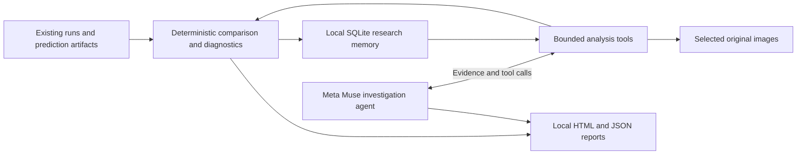

# CV Scientist

**An evidence-driven research copilot for computer vision engineers.**

CV Scientist helps answer the question between training runs: **what should we
try next, and what evidence justifies it?** It connects experiment history,
class-aware error analysis and a Meta Muse agent in a local workspace. Findings
link back to experiments and image records; proposed improvements remain
hypotheses until measured evaluations support them.

Built for the **Push the Frontier** problem statement in the Meta Global AI
Developer Hackathon. See [original contributions](docs/contributions.md),
[submission requirements and judging rubric](docs/hackathon.md), and the
[three-minute demo script](docs/demo.md).

## Why it exists

A better aggregate score can hide worse recall for small defects. Training logs,
image errors and previous attempts often live in different places. Engineers
repeat failed ideas or spend another GPU run before checking the evidence.

CV Scientist keeps that evidence together: import runs, compare metrics and
configurations, inspect FP/FN images, ask Muse to investigate, and retain the
result for the next decision. Its current target user is a CV engineer improving
an object detector, including industrial inspection workflows.

## Try it locally

Python 3.10+ with SQLite FTS5. The public demo needs no API key, GPU, private
dataset or external training project.

```bash
python3 -m venv .venv
source .venv/bin/activate
python -m pip install -e '.[dev]'
python examples/create_demo.py --output demo-workspace
cv-scientist --project demo-workspace compare B0 E1 --json
cv-scientist --project demo-workspace diagnose E1 --json
cv-scientist --project demo-workspace report E1 --baseline B0 --json
```

Open the HTML file returned by `report`. It includes comparison tables,
regressions, class confusion and original images with GT/prediction overlays.
The fixture deliberately improves precision while losing small-defect recall.
Its images and predictions are **synthetic**, no detector is trained, and no mAP
is claimed. Re-running the generator against an existing output fails without
overwriting it; choose another output directory for a fresh demo.

## Use Meta Muse to investigate

```bash
source .venv/bin/activate
cv-scientist config
cv-scientist --project demo-workspace ask \
  "Compare B0 and E1. Inspect the missed small defects and cite the image evidence. What should we test next?" \
  --agent meta --model muse-wonder-1.0 --json
```

`config` prompts for a key without displaying it and saves it outside the
repository. `CV_SCIENTIST_API_KEY` is the environment override; an explicitly
empty value is an error. Spark is also supported with `--model muse-spark-1.3`.
Meta calls require your account access and may incur charges. Selected image
previews and tool results are sent to Meta; generated reports remain local.

The integration uses Meta Model API Chat Completions, function tools,
multimodal image input and strict JSON schemas. Muse retrieves project evidence,
requests diagnostics and views selected errors before answering. The application
validates cited kind/ID pairs and enforces request, image and token limits.
Reference validation does not prove every causal explanation. See
[Meta integration](docs/meta-integration.md) for code locations and boundaries.

## What works today

| Capability | Behavior |
|---|---|
| Run ingestion | Local artifacts, persistent lineage, original/working/best baselines, repeat-ingest deduplication |
| Diagnostics | Class-aware FP/FN matching, localization/duplicate/background groups and class confusion |
| Meta investigation | Tool-using Muse agent with original-image inspection and validated evidence references |
| Dataset review | Read-only YOLO/image audit plus a bounded Meta visual sample; reports actual coverage |
| Dataset annotation | Muse converts your description into per-class SAM 3.1 prompts; Meta API labels every image into a separate YOLO detection dataset |
| Existing run import | Meta-assisted field mapping from local/SSH results into immutable local metadata copies |
| Experiment memory | SQLite history, FTS5 search, hypotheses, questions, conclusions and user notes |
| Bounded research | Confidence-only or resolution-only evaluation through the supported external adapter; budgets and crash recovery |
| Evidence reports | Local HTML comparison, error overlays and research outcomes, without a hosted UI |
| Agent integration | Versioned `--json` CLI usable from coding agents and scripts |

The bounded evaluator requires a compatible evaluation script and real weights;
it is separate from the synthetic demo. General-purpose autonomous training and
an autonomous Modal training loop are not implemented. The optional Modal
scripts in `scripts/` are manually invoked case-study launchers for existing
private volumes, not a prerequisite for the public demo.

To annotate your own local image folder using the configured Meta key:

```bash
source .venv/bin/activate
cv-scientist --project demo-workspace annotate-dataset /path/to/images \
  "Annotate every person and car" --output /path/to/new-yolo-dataset --json
```

Muse plans the classes from your description and up to four previews, then
`sam-3.1` processes every image once per class through Meta's Responses API.
The new directory contains `data.yaml`, images, YOLO boxes and an annotation
manifest with prompts and source mappings. Existing source labels stay intact.
These are draft labels for human review. This sends every image to Meta, requires
SAM account access and incurs API usage. See [annotation details](docs/usage.md#dataset-annotation-with-sam-31).

## How it fits together



## Evidence and limitations

In a real detector case study, four controlled interventions were evaluated
against the same validation set. None passed all prespecified improvement
criteria; a small F1 increase still increased fire false positives. CV Scientist
stored and compared those outcomes without promoting a failed intervention.
The training jobs and the larger annotation review were orchestrated separately
by a coding agent. This is evidence of the analysis workflow, not proof of
end-to-end autonomous training or production quality.

[Case-study results](docs/case-study.md) include the measured values, controls
and attribution. Private images, annotations, weights, raw reports and credentials
are excluded from this repository. The public industrial-inspection demo uses
only generated assets.

## Development

```bash
source .venv/bin/activate
python -m pytest tests/ -q
python -m cv_scientist.offline_eval --output /tmp/cv-scientist-offline-eval.json
python -m cv_scientist.retrieval_eval --output /tmp/cv-scientist-retrieval-eval.json
```

Tests use temporary data and scripted model responses. They verify application
behavior and guardrails; they do not measure live Muse reasoning quality.
GitHub Actions runs tests and the synthetic demo without API credentials.

- [CLI and artifact reference](docs/usage.md)
- [Reproducibility and data provenance](docs/reproducibility.md)
- [Local verification and remaining checks](docs/verification.md)
- [Contributing](CONTRIBUTING.md)
- [MIT license](LICENSE)
